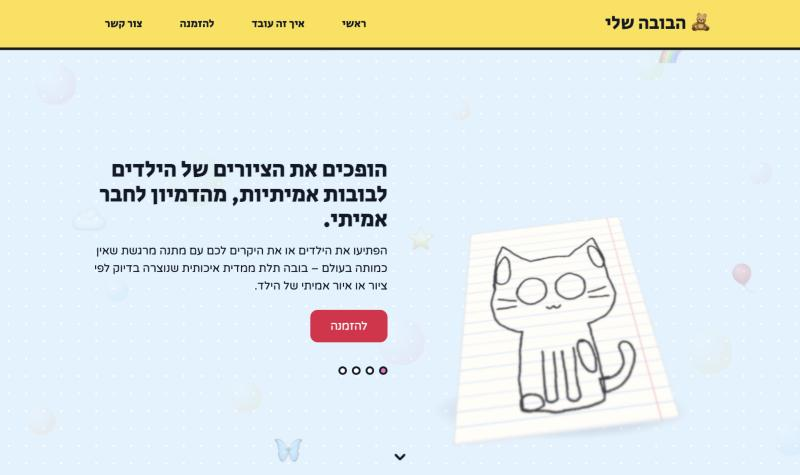
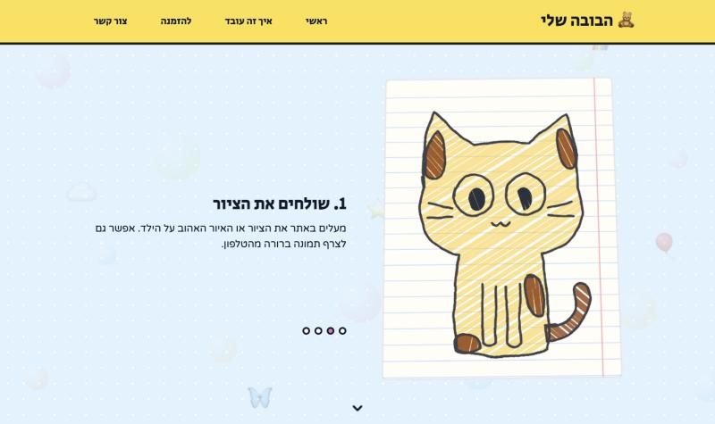
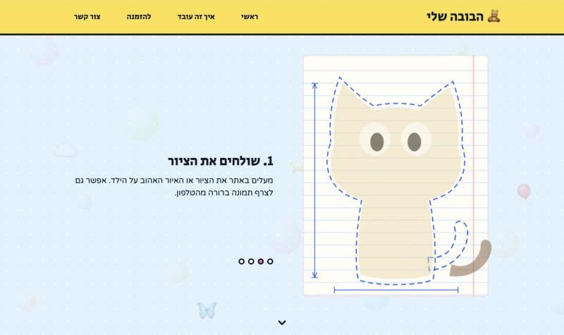
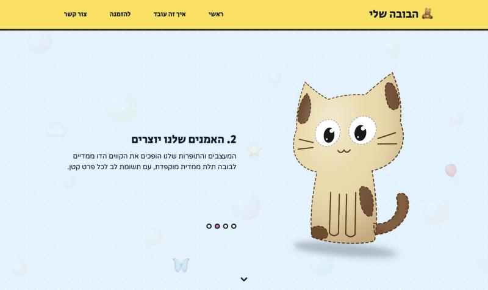
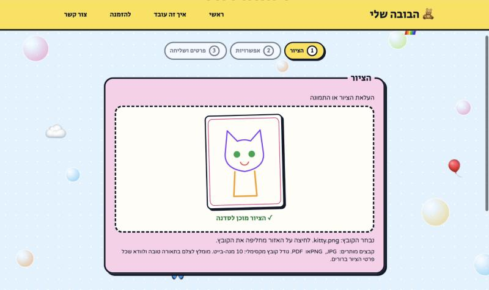
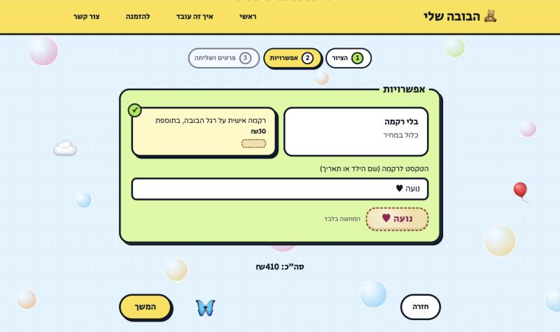

# Custom Doll Store — From a Child's Drawing to a Handmade Doll

A Hebrew, right-to-left online store for a small business that sews plush dolls from children's drawings.
Built end to end — product decisions, interaction design, backend, security and launch planning — using an AI coding agent (Claude Code) as a pair programmer, with me as product owner and reviewer.

**Liel Leone** — Industrial Engineering & Management (Data Science track), Ariel University.
Live site (pre-launch, orders closed): [lielleone.pythonanywhere.com](https://lielleone.pythonanywhere.com/)

| The drawing rests on a desk | The camera dives in and it is coloured | It becomes a sewing pattern | Sewn into a doll |
|---|---|---|---|
|  |  |  |  |

---

## At a Glance

| | |
|---|---|
| Stack | Python · Flask · Jinja · SQLite · Tailwind CSS (compiled locally) · GSAP (ScrollTrigger, DrawSVG, MorphSVG) |
| Scope | 14 routes, 6 Python modules · ~1,400 lines of Python, ~1,200 of HTML templates, ~700 of JavaScript |
| Timeline | About 50 commits, October–November 2026, on feature branches merged into `main` |
| Hosting | PythonAnywhere (WSGI, behind a reverse proxy, HTTPS) |
| Status | Deployed in pre-launch mode; opening for orders waits on the launch checklist below |

## The Problem

The owner makes one product: a plush doll sewn from a child's drawing — 380 NIS including delivery, with personal embroidery for 30 NIS more.
She needed customers to upload a drawing and place an order from their phone, and a simple way to manage those orders.

The constraints shaped most of the decisions:

- **Not ready to take money yet.** Business registration and a payment provider are still open, so the site must collect orders without charging and without pretending to.
- **Legal texts are drafts.** Terms, cancellation, privacy and accessibility statements need professional review before real customers arrive.
- **A product for children.** Nothing may claim safety standards or compliance that has not been verified.
- **Hebrew, right to left, mostly mobile.**

## What I Built

**For customers**

- **Scroll story** — the home page hero tells "how it works" visually: a child's crayon sketch lies on a desk, the camera dives in, the drawing is coloured, turns into a cutting pattern, the felt pieces are cut, joined and sewn (a needle follows the outline), light and depth are added, and it crossfades to a real felt doll. The drawing is a generated SVG; the motion is GSAP ScrollTrigger.
- **Order wizard** — three steps instead of one long form:
  1. *Drawing workshop* — drop or choose a file; a local preview is scanned and stitched before anything is uploaded. Type and size are checked with the same Hebrew messages the server uses.
  2. *Options* — embroidery as two cards, a live felt-patch preview of the text, and a live total.
  3. *Details and consent*, then "send to the workshop" with a short stitch-and-stamp animation that also blocks double submission.
- **Interactive gallery** — photos open in an accessible dialog; a soft tilt and light sheen follow the mouse.
- **Draft legal pages** with a visible draft banner, and a consent checkbox stored with each order.

| Drawing workshop | Embroidery options |
|---|---|
|  |  |

**For the owner**

- Password-protected admin: orders list, order details, status changes, the uploaded drawing.
- New-order email notification.
- A one-click clean-up of test orders made in preview mode.

## Product and Business Decisions

| Decision | Why |
|---|---|
| Removed the "giant" size option | The supplier cannot make it. Old orders keep their label so the admin still works. |
| Embroidery as a paid add-on with a live total | A clear upsell, and no surprise at the end of the form. |
| One switch, `ORDERS_OPEN`, with three states: closed, preview, open | Closed: the site can go online and be shown to friends and family without taking orders. Preview: the real form for test runs, orders marked as tests and deletable. Open: real orders. |
| The app refuses to open orders while the legal pages are drafts | Turns a launch-checklist item into an enforced rule: with `APP_ENV=production` and orders open, it will not start while a draft flag or a `[placeholder]` remains. |
| Removed unverified safety and standards claims from the copy | For a children's product this is a regulatory and trust risk. It is now a written rule for future changes. |
| Removed a photo showing another brand's label and an identifiable person; consent rule for photos of children | Intellectual property and privacy. |
| No invented gallery categories, fabrics or sizes | Show only what the business really offers. |
| Pre-launch: hidden from search engines, but link previews kept | Word of mouth over WhatsApp works before the site is ready to be found. |
| The thank-you page does not mention payment | Payment is not connected; the page says what really happens next. |

## How I Worked with AI

The code was written with Claude Code. My part was the product: defining what to build and why, setting the rules, reviewing every step and deciding what ships.

- **A living spec.** [`CLAUDE.md`](CLAUDE.md) holds the product facts, the rules and the current status: never read or print secrets or customer data, Hebrew and RTL, accessibility, no unverified claims, small steps with a commit after each. It was updated as decisions were made, so each new task started from the same ground truth.
- **Small, testable requests.** Each round was a numbered list with acceptance criteria and test requirements, worked on a feature branch, one commit per item.
- **Verification outside the real data.** Every change was run in a throwaway copy of the code with a fresh database and a dummy secret, never against the real `.env`, database or uploads. Checks covered order flow, CSRF, rate limits, schema migration, the no-JavaScript fallback, headers, SEO tags and layouts from 375 px to 1440 px.
- **Guardrails.** Permission rules in [`.claude/settings.json`](.claude/settings.json) block the agent from reading secrets and customer files.
- **Review caught real issues**, for example: the CSRF check accepted an empty token; the honeypot field's `left: -9999px` made the right-to-left order page scroll sideways on phones; and an early version of the wizard hid the send button when JavaScript was off. All were fixed before merging.

## Design and Accessibility

- A playful "sticker" visual language (thick outlines, offset shadows, pastel cards) in Hebrew, right to left.
- **Progressive enhancement:** without JavaScript every page still works as a plain page — the story becomes a normal hero with the steps listed, the gallery photos are links, the wizard is a one-page form.
- `prefers-reduced-motion` is respected; visible focus states, labelled fields, keyboard-operable dialog and wizard.
- No accessibility level is claimed — the accessibility statement says a professional audit has not been done yet.

## Security and Deployment

- CSRF tokens on every form, a honeypot field and per-IP rate limits (orders, admin login), with IPs stored only as an HMAC.
- Admin password stored as a hash; session cookie HttpOnly, SameSite=Lax, Secure in production; admin session expires after 8 hours.
- Security headers on every response; all scripts and the compiled CSS are served locally (only the fonts come from Google Fonts), which keeps a future Content-Security-Policy simple.
- Server-side validation of every field and of the uploaded file's real type.
- `TRUST_PROXY` for the host's reverse proxy; `DATA_DIR` keeps the database and uploads outside the code folder; `APP_ENV=production` refuses to start with unsafe settings and lists every problem.
- The deploy package is built with `git archive`; `.gitattributes` keeps development files out of it.

## Repository Structure

| Path | What it is |
|---|---|
| `app.py` | App setup, pages, SEO routes, security headers, production checks |
| `orders.py` | Order form, validation, upload handling, SQLite storage and migration |
| `admin.py` | Owner login and order management |
| `security.py` | CSRF, rate limiting |
| `mailer.py` | New-order email |
| `legal.py` | Draft legal texts and the launch lock |
| `templates/` | Jinja templates; `partials/story_cat.svg` is the story drawing |
| `static/js/` | `story.js` (scroll story), `gallery.js`, `order.js` (wizard) |
| `static/src/` | Tailwind input and the generator for the story drawing |
| `static/vendor/gsap/` | GSAP 3.15.0, vendored with source and hashes |
| `CLAUDE.md` | The project spec used with the AI agent |

## Running Locally

```bash
python3 -m venv venv && source venv/bin/activate
pip install -r requirements.txt
```

Create a `.env` file next to `app.py`:

```
SECRET_KEY=any-long-random-string
ADMIN_PASSWORD_HASH=<output of the command below>
ORDERS_OPEN=1
```

```bash
python -c "from werkzeug.security import generate_password_hash; print(generate_password_hash('choose-a-password'))"
python app.py          # http://127.0.0.1:5001 , admin at /admin
```

After changing CSS classes in the templates, rebuild Tailwind with the standalone CLI (see `CLAUDE.md`).

> Photos of customers' children and the owner's contact details are not part of the public repository; illustrations and example values stand in for them.

## Status and Next Steps

- Professional review of the legal pages, then removing the draft flag
- Written answer from the Standards Institute of Israel before any safety wording
- Business registration and a payment provider; thank-you page updated to match
- Domain, then opening orders
- Content-Security-Policy header; moving the verification scripts into a committed test suite

---

### בעברית בקצרה

אתר הזמנות בעברית לעסק קטן שתופר בובות בד לפי ציורים של ילדים. בניתי אותו מקצה לקצה בעזרת סוכן AI לכתיבת קוד (Claude Code). אני הגדרתי את המוצר, קבעתי את הכללים ואת ההחלטות העסקיות, ובדקתי ואישרתי כל שלב.

בדף הבית יש סיפור בגלילה שבו ציור של ילד הופך לבובה. ההזמנה עצמה היא אשף בשלושה שלבים, עם תצוגה מקדימה של הציור ושל הרקמה.

גם ההחלטות העסקיות מתועדות בקוד:
- מצב טרום-השקה, כדי שאפשר יהיה להציג את האתר בלי לקבל הזמנות;
- נעילה שמונעת פתיחת הזמנות לפני בדיקה משפטית;
- הסרה של טענות בטיחות שלא אומתו.

© 2026 Liel Leone. All rights reserved. The code is shared for portfolio review.
